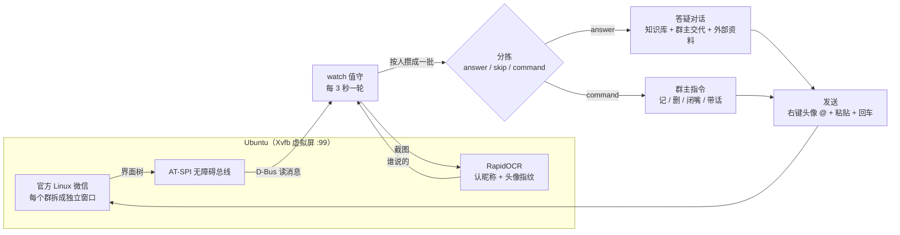

<div align="center">

# 🤖 wechat-group-qa-bot

**一个「坐在电脑前看群」的微信群答疑机器人**

用官方 Linux 微信 + 系统无障碍接口读群，用大模型答题，用剪贴板和键盘回复。<br>
不注入、不 Hook、不抓包、不碰协议，把封号风险压到最低。


</div>

---

## ✨ 它能做什么

| | |
|---|---|
| 💬 **自动答疑** | 按你写的知识库回答群友问题，答不上的照实说、叫群主，不瞎编 |
| 🧭 **先分拣再回答** | 每批消息先过一道便宜的「分拣」：该答的答，闲聊、斗图、群主已在回的人一律不插嘴 |
| 🖼️ **能看图** | 群友发的报错截图点开大图，交给能看图的模型，转成文字再答 |
| 📣 **真 @ 人** | 右键头像点「@」插入真正的提醒，不是贴一串文字 |
| 👑 **认得群主** | 名字对上还要点开头像核对微信号，同名冒充的下不了指令 |
| 🗣️ **听群主指挥** | 群主 @ 它说「记一下」「这条删掉」「闭嘴一小时」「带话给开发」，当场办 |
| 🌙 **夜里自学** | 每天定点带着前一天没答上的问题上网查官方文档，整理成资料；跟知识库冲突的列出来等群主拍板（见[知识从哪来](#-知识从哪来)） |
| 💾 **挂了接着干** | 对话和待发回复都存在 SQLite（pi-durable），进程重启不丢、不重发 |

## 🛡️ 为什么这么选：把封号风险降到最低

微信机器人常见的做法有三种，风险从高到低：

| 做法 | 原理 | 封号风险 | 我们 |
|---|---|---|---|
| **Hook / 注入** | 往微信进程里注 DLL，直接调内部函数、读内存 | 🔴 最高：改了客户端，特征明显，历次封号潮的重灾区；微信一更新就失效 | ❌ |
| **协议逆向**（iPad / Web / Mac 协议） | 抓包还原私有协议，自己当客户端连服务器 | 🟠 高：服务器看到的是「非官方客户端」，设备指纹、行为都可能对不上 | ❌ |
| **UI 自动化** | 官方客户端原样跑，像人一样「看屏幕、点鼠标、敲键盘」 | 🟢 最低：服务器看到的就是一台正常登录的电脑 | ✅ |

我们在 UI 自动化里又选了最「安静」的一条路：

1. **官方客户端，一个字节都不改。** 用的是微信官网下载的 Linux 版，扫码登录，没有补丁、没有注入、不读内存、不解密本地数据库。
2. **读消息走系统无障碍接口（AT-SPI）。** 读屏软件给盲人朗读界面用的就是这个接口，是操作系统的正规能力，不是钻微信的空子。拿到的只有屏幕上本来就显示的文字和位置。
3. **发消息就是粘贴加回车。** 剪贴板贴进输入框、按回车，跟人手动发一模一样；@ 人是右键头像点菜单。
4. **节奏像人。** 一个人连发几句，等他停 8 秒再整批回一次；回复限 80 字左右、超长不发；每人每分钟最多看 3 张图。
5. **跑在虚拟屏里。** Ubuntu 上用 Xvfb 起一块看不见的屏幕，独立的 D-Bus 和 HOME，不需要显示器，也不跟桌面抢鼠标，7×24 挂着。
6. **用小号，只进自己的群。** 不加好友、不私聊、不群发、不拉人。

> ⚠️ 风险最低不等于零风险。任何非官方的自动化都可能违反微信的使用协议。请用小号，控制频率，只在你自己管理的群里用。

## 🏗️ 怎么跑起来的



- **认人**：消息条目里只有正文和坐标，没有发言人。所以截一张图，用 OCR 读气泡上方的昵称；读不准的用头像的 8×8 指纹区分。右边有头像的是机器人自己。
- **认群主**：名字是群主的，再点开头像读资料卡上的微信号，和你预先存的 `owner_wxid` 对上才算。
- **一个持久对话**：整个群的答疑是一条一直聊下去的对话，上下文太长时自动压缩。群主指令每次开一个新对话，只有它能写「群主交代」，群友怎么诱导都改不了规则。

## 🧠 知识从哪来

机器人回答时只把「有出处的」当定论。知识分四层，优先级从高到低：

| 层 | 文件 | 谁写 | 怎么进来 |
|---|---|---|---|
| 👑 **群主交代** | `群主交代.md` | 群主 | 在群里 @ 机器人说「记一下……」「这条不对，删掉」，当场写入；跟知识库冲突以它为准 |
| 📘 **内部知识库** | `knowledge.md` | 群主 | 自己维护（照 `knowledge.example.md` 写），每次回答现读，改完立即生效 |
| 🌐 **外部资料** | `外部资料.md` | 机器人 | 夜里自学写的，带来源链接和日期 |
| ⏳ **待群主确认** | `待群主确认.md` | 机器人 | 自学查到、但跟知识库说法对不上的，列在这等群主拍板；**回答时不用** |

**夜里自学怎么跑**（`src/research.ts`）：

1. 每天定点（默认凌晨 3 点）醒来，翻过去一天群里的消息；
2. 挑出没答上的、知识库里没有的问题；
3. 上网搜，优先官方文档、公告和更新日志，必要时打开原文看；
4. 整理成一两句一条、带来源和日期的资料，整体覆盖写进 `外部资料.md`；
5. 查到的跟知识库对不上，不写进资料，列进 `待群主确认.md`。

**为什么不从群聊里自动学**：群友说的话不会直接变成知识。只有群主能写前两层，机器人自己查到的只能进外部资料，冲突的等人拍板。不然有人在群里教它一句「全场免费」，它就当真了。

> 自学要一个[博查](https://open.bochaai.com)搜索的 key（放在 `bocha_key`）。不放也能跑，只是没有外部资料这一层。

## 🚀 快速开始

> 下面以 Ubuntu 24.04 为例。别的发行版只要有 Xvfb、AT-SPI 和官方微信也能跑。

**1. 装系统依赖**

```bash
sudo apt install -y xvfb at-spi2-core dbus-x11 xdotool xclip x11-apps fonts-noto-cjk python3-venv
```

**2. 放好微信和代码**

```bash
git clone https://github.com/<你>/wechat-group-qa-bot ~/wxbot && cd ~/wxbot
# 从 https://linux.weixin.qq.com 下载官方 deb，解到 ./wechat（不用 root 安装）
dpkg -x WeChatLinux_x86_64.deb ./wechat
npm ci
python3 -m venv ocr && ocr/bin/pip install rapidocr_onnxruntime numpy pillow
```

**3. 填配置**

```bash
echo 'sk-...' > api_key && chmod 600 api_key       # 任意 OpenAI 兼容接口的 key
cp knowledge.example.md knowledge.md                # 写你自己群的知识库
vim prompt.md                                       # 改【说话方式】成你的口气
```

**4. 起微信、扫码登录**

```bash
systemd-run --user --unit=wxbot --collect ~/wxbot/start.sh
./run.sh shot qr.png        # 截虚拟屏，拿手机扫 qr.png 里的二维码
```

登录后把要盯的群在会话列表里置顶，机器人会自动把它们拆成独立窗口排好。

**5. 认群主、先空跑**

```bash
./run.sh whois              # 点群主头像读微信号，确认读得到
echo '群主的微信号' > owner_wxid
WXBOT_GROUPS=我的群 WXBOT_OWNERS=群主昵称 WXBOT_NAME=机器人昵称 \
WXBOT_API_BASE=https://你的接口/v1 WXBOT_MODEL=你的模型 ./run.sh watch
```

默认是**只读**：回复只写进 `drafts.jsonl`，不往群里发。看几天草稿觉得靠谱，再把群名写进 `live_groups`（一行一个），这个文件每次发之前现读，不用重启。

## ⚙️ 配置

| 环境变量 | 说明 | 默认 |
|---|---|---|
| `WXBOT_GROUPS` | 要盯的群名，逗号分隔（同名的几个都盯，按人数区分） | `示例群,示例2群` |
| `WXBOT_OWNERS` | 群主在群里的昵称，逗号分隔（只是触发核对，微信号对上才算） | `老板` |
| `WXBOT_NAME` | 机器人小号在群里的昵称（别人 @ 它用的名字） | `答疑助手` |
| `WXBOT_API_BASE` | OpenAI 兼容接口地址 | `https://api.openai.com/v1` |
| `WXBOT_MODEL` | 分拣、答疑、看图用的模型（要能看图） | `deepseek-v4.1-flash` |
| `WXBOT_RESEARCH_MODEL` | 夜里自学用的模型 | `kimi-k3.1-pro` |
| `WXBOT_RESEARCH_HOUR` | 每天几点自学 | `3` |
| `WXBOT_DRY` | 设了就只填输入框、不按回车（试发用） | |

| 文件 | 说明 | 进仓库 |
|---|---|---|
| `prompt.md` / `router.md` | 答疑规则、分拣规则，每次请求现读，改完立即生效 | ✅ 模板 |
| `knowledge.md` | 你的知识库 | ❌ |
| `api_key` / `bocha_key` | 模型接口 key、博查搜索 key（不用自学可以不放） | ❌ |
| `owner_wxid` | 群主微信号 | ❌ |
| `live_groups` | 开了真发的群 | ❌ |
| `群主交代.md` / `外部资料.md` / `待群主确认.md` | 运行中生成 | ❌ |

## 🧯 护栏

- **默认只读**：没写进 `live_groups` 的群只出草稿。
- **群友永远下不了指令**：分拣结果在代码里再兜一层，群友的消息不可能走到能写文件的那条路。
- **不答非所问**：回复 @ 的人这批里没开口，就不发。
- **不乱说**：模型答完不收、往下编对话的部分会被截掉；`<thinking>` 思考段剪掉；截完还超过 400 字就不发。
- **能闭嘴**：群主说「闭嘴」只在那个群闭嘴，别的群照常。
- **防刷钱**：看图按人、按全群限速。

## 🧰 命令

```bash
./run.sh watch                  # 值守
./run.sh sim "小王：报错 401" "【群主】老板：@答疑助手 记一下 xxx"   # 一段假群聊走完整流程
./run.sh ask "怎么装"           # 单问一句
./run.sh names                  # 各群屏上每条认成了谁
./run.sh whois                  # 再核对群主微信号
./run.sh sendtest 群名 "内容"   # 手动发一条（先停值守）
./run.sh dump | shot a.png      # 打印界面树 / 截虚拟屏
./run.sh research-now 问题…     # 立刻自学一次
npm run selftest && npm run check
```

## 📁 目录

```
src/
  watch.ts     值守：读群、攒批、分拣、派活
  wechat.ts    微信界面：AT-SPI 读消息、截图、认人、排窗口、粘贴发送、真 @
  router.ts    分拣（一次便宜的非流式调用 + 代码兜底）
  group.ts     答疑对话：规则、知识库、发送任务、回复把关
  owner.ts     群主指令：记、删、闭嘴、带话
  research.ts  夜里自学
  vision.ts    看图
  model.ts     OpenAI 兼容接口接入
ocr.py         常驻 OCR 进程（昵称 + 头像指纹）
start.sh       起虚拟屏、无障碍总线、微信
docs/          方案调研
```

## 📚 延伸阅读

- [Ubuntu 方案和 Windows 方案的区别](docs/Ubuntu与Windows方案对比.md)

## 🙏 依赖

- [pi-durable](https://www.npmjs.com/package/@earendil-works/pi-durable)：持久对话和任务（MIT）
- [RapidOCR](https://github.com/RapidAI/RapidOCR)：昵称识别
- [dbus-next](https://github.com/dbusjs/node-dbus-next)：读 AT-SPI

## 📄 许可

[MIT](LICENSE)。本项目与腾讯无关；微信是腾讯的商标。用它产生的一切后果自负。
